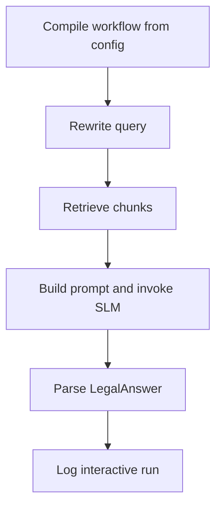

# legalos_rag

**Local helper package** for the RAG pipeline: config validation, graph orchestration, query rewriting, retrieval, prompt building, SLM invocation, and logging. Used by `chatbot/main.py` and `test.promptTester.promptRunBatch`. The separate `sourceLoader`, `sourceReview` and `sectionLookup` entry points import candidate sources, check them against their PDFs, and fetch complete sections. `questionSplitter` splits a question into legal parts and `factExtractor` records the facts a user states, `referenceAgent` resolves a named Act and section, `keywordSearch` ranks excerpts by keyword, `retriever` merges keyword and vector search, `evidenceFilter` drops results that only mention the topic, `evidenceAgent` gathers evidence for each question part, `conditionCheck` marks a section's conditions against stated facts, `applicabilityAgent` decides what can be said about a situation, `contextCompactor` shortens the evidence for the answer step, `answerAgent` writes the answer, and `evaluator` checks it.

---

### Directory structure

```text
legalos_rag/
├── README.md
├── __init__.py
├── runRag.py
├── queryRewriter.py
├── sourceLoader.py
├── sourceReview.py
├── sectionLookup.py
├── structuredCall.py
├── questionSplitter.py
├── factExtractor.py
├── referenceAgent.py
├── keywordSearch.py
├── retriever.py
├── evidenceFilter.py
├── evidenceAgent.py
├── conditionCheck.py
├── applicabilityAgent.py
├── contextCompactor.py
├── answerAgent.py
├── evaluator.py
├── workflow.py
└── prompt/
    ├── promptSchema.py
    └── prompts.py
```

---

## Module structure & execution flow

### `__init__.py`

- **_setup_slm(model_name)** — Build Ollama ChatOllama instance with the specified model name (temperature `0.3`).
- **ensure_requirements(config)** — Validate config and return `(db_path, promptTemplate, slm, model_name, logging)`. Required config keys:
  - `vectordbpath` — path to the Qdrant vector DB.
  - `promptTemplate` — object with a `"text"` key holding the full prompt template string.
  - `model.model_name` — Ollama model name (e.g. `"qwen2.5:3b-instruct"`).
  - `logging` (optional for batch runner) — object with `logfile`, `exclude_model_name`, `exclude_prompt`.


Used by both the interactive CLI (`chatbot.main`) and the batch runner (`test.promptTester.promptRunBatch`).

### `prompt/promptSchema.py`

Pydantic schemas for structured outputs: `LegalAnswer` (answer_found, act_name, section, explanation, citations) and `Citation` (pdf_number, page, file_name, quote).

### `prompt/prompts.py`

- Builds the **RAG prompt skeleton**:
  - Takes a full prompt template string (from config’s `promptTemplate.text`).
  - Injects `format_instructions` from the output parser.
  - Returns a LangChain `PromptTemplate` with `input_variables=["facts", "question"]` and `partial_variables={"format_instructions": ...}`.

### `queryRewriter.py`

- **rewrite_and_expand(query, slm)** — Uses the same Ollama model as the main SLM (temperature `0.3`) with a small legal-terminology prompt and `PydanticOutputParser` to produce two short search strings: **`rewritten`** (main issue in statutory-style language) and **`variant`** (related angle such as remedy or procedure). The model is instructed not to name specific Acts. Returns `[original, rewritten, variant]` on success, or `[original]` if parsing or the SLM fails (retrieval still runs on the user query only).

### `runRag.py`

Central RAG logic:

- **getFacts(q, db_path)** — Setup Qdrant vectorstore (HuggingFace embeddings), retrieve top-k chunks for a single query string, return them formatted as a single string for the prompt. Still available for single-query retrieval.
- **retrieve_documents(queries, db_path)** — For each query string, runs `similarity_search_with_score` with `k=3`, deduplicates hits by `(pdf_number, page)`, and returns up to **5** documents, retaining their text, IDs, and full metadata.
- **format_documents(docs)** — Formats documents into the existing `[DOC n]` prompt blocks with PDF number, page, and file name.
- **getFactsMulti(queries, db_path)** — Calls `retrieve_documents` and `format_documents` to keep the existing string-returning retrieval interface.
- **invoker(slm, retrievedChunks, query, template)** — Build output parser for `LegalAnswer`, build prompt from `prompt/prompts.setup_rag_prompt_skeleton`, format with facts and **the original user question** (not the rewrite), invoke the SLM, parse response into `LegalAnswer`. Returns `(parsed_result: LegalAnswer, final_prompt_text: str)`. Does **not** log.
- **log_rag_run(query, final_prompt, output, model, log_file, exclude_model_name, exclude_prompt)** — Append one RAG run as a JSONL line to the given log file. Called from `run_rag_loop()` in `chatbot/main.py` after each single RAG run (not from `run_rag`, which does not log).

### `sourceLoader.py`

`load_sources(config)` reads the configured POC JSON snapshots and their PDFs,
checks both SHA-256 hashes and source metadata, validates section records, and
returns one `{"sources": [...]}` corpus. The command writes this corpus only
after every source passes those structural checks. Setup, required inputs, and
the exact command are in [POC source loading](../README.md#load-the-poc-law-sources).

Each source contains its Act ID and name, PDF filename, `source_version` (the
PDF's SHA-256), snapshot JSON hash, update label, PDF page count, extraction and
coverage notes, footnotes, `review_status`, and `sections`.

Each section contains its number, title, unchanged snapshot `text`, PDF `pages`,
page footnotes, and `excerpts`. A section's `source_id` is
`<act_id>:<pdf_sha256>:section:<number>`. Excerpt IDs append
`:chars:<start>-<end>`; offsets are zero-based Python string positions with an
exclusive end, and each excerpt is exactly `section["text"][start:end]`.
Excerpts are at most 1,200 characters and split at spaces where possible.
Joining them reproduces the full section text without dropping qualifications.
These are search-sized excerpts, not independently complete legal rules.

Pages are the snapshot's **one-based PDF page numbers**, not the legacy vector
store's page indices. Excerpts inherit their parent section's page range; the
loader does not claim a precise page for each excerpt. Page-level footnotes are
retained separately from section body text, including any extraction artifacts.

All records have `review_status: "unreviewed"`. Matching hashes establish which
files were imported; they do not certify that extraction captured every
condition or section boundary correctly. The loader preserves the POC text for
the separate source-quality review and has no connection to the live RAG graph.
It does not enable a source, build a vector index, or require a model call.

### `sourceReview.py`

`review_sources(config)` checks every Act in the loaded corpus against its PDF and
returns one `passed` or `failed` record per Act with its `source_version`, the
number of sections checked, and a list of findings. `review_source(source,
pdf_directory)` does this for one Act. The command writes the result to the
`review_file` in the config. The checks work on words only (letters, lower case), so
footnote markers and punctuation in the PDF do not matter.

- **PDF identity** — the PDF page count equals `source_pages` and the first part of
  the Act's name (up to its first comma) appears at the start of the PDF. The file hash was already checked when the
  sources were loaded.
- **Section boundaries** — a section heading is accepted only if a line starting
  with the section number, followed by the same first title words, is found on the
  section's first recorded page and after the previous section's heading.
- **Section text** — the PDF words between a heading and the next heading (or the
  end of the section's last page) must appear in the section text and its footnotes.
  A section fails when more than 5% of them (at least 5 words) are missing.
- **Qualifications** — each `Provided that`, `Explanation`, `Exception` and
  `Illustration` that opens a clause in the PDF must also be in the section.
  Amendment notes such as "for the Explanation" are not counted.

Chapter headings are not section text and are skipped. Reading stops at the first
schedule heading on or after the last section's first page, so schedules are not
mistaken for section text; schedule headings in the table of contents are ignored.
The check does not review Schedules or associated Rules.

`load_verified_source(config, act_id)` is the gate for the new retrieval path. It
returns an Act only when the review file shows `passed` for that Act's current
`source_version`, and raises `ValueError` for an unknown Act, a failed or missing
review, or a source version that has changed since the review. Nothing calls it yet;
later steps use it before reading an Act.

Passing is a text comparison with the PDF, not legal approval. Findings are not
waived automatically; an Act with any finding stays refused until it is reviewed.

### `sectionLookup.py`

`fetch_section(config, source_id)` returns the complete section for a section ID
(`<act_id>:<source_version>:section:<number>`) or one of its excerpt IDs (the same
ID plus `:chars:<start>-<end>`). A search that finds an excerpt can call it to read
the whole provision, so provisos, explanations and other conditions outside the
excerpt are not lost.

The result has `act_id`, `act_name`, `source_version`, the section's `source_id`,
`section`, `title`, `text`, `pages` and `footnotes`. `text` is the unchanged section
text; the excerpts are not returned. The function calls
`sourceReview.load_verified_source`, so it works only for an Act that has passed its
source check for the ID's `source_version`. It raises `ValueError` for a malformed
ID, an unknown Act, section or excerpt, a different source version, or an Act that
has not passed. The `sectionLookup` command prints the same result as JSON; usage is
in [Fetch a complete section](../README.md#fetch-a-complete-section).

### `structuredCall.py`

`ask_model(slm, template, schema, **inputs)` fills a prompt template, calls the same
Ollama model as `slm` at temperature 0, and parses the reply into a Pydantic schema,
using the same parser as the query rewriter. If the small model adds text after the JSON or
answers with the schema's own wrapper (`{"properties": {...}}`), it reads the first JSON object
and unwraps that shape. It still raises on any other parse or model error so each caller
chooses its own fallback. A model that echoes the schema's field description as the value
cannot be repaired and raises.

### `questionSplitter.py`

`split_question(question, slm)` returns `{"question": <original>, "parts": [...]}`.
Each part is `{"id": "p1", "question": ..., "facts": [...]}`. The model proposes the
parts and code checks them:

- **Facts** are kept only when they are exact phrases of the original question
  (compared on words, ignoring case and punctuation).
- **Wording**: a part may rearrange the user's words but at most 20% of its words may
  be new; otherwise the whole question stays one part.
- **Size**: zero parts or more than four parts also keep one part.
- **Failure**: any model or parse error keeps one part.

The prompt asks for one part unless the user asks about different Acts or unrelated
situations. Several details of one problem, such as where to file and the deadline,
stay together.

Measured with `qwen2.5:3b-instruct` on 18 reviewed questions (12 written first, 6 held
back and run once): 16 gave a defensible number of parts. None of the 8 single-problem
questions was split. Two questions with unrelated situations in one flowing text, not
named Acts, stayed as one part. This under-splitting loses no facts. The `facts` list
is best effort: the model sometimes leaves it empty even when the part's own text
states the fact. Exact fact extraction is a separate step. Nothing in the live graph
calls the splitter yet.

### `factExtractor.py`

`extract_facts(question, slm)` returns `{"question": <original>, "facts": [{"id": "f1", "quote": ...}]}`. The model proposes quotes and code keeps a quote only when:

- it appears word for word in the question (ignoring case and spacing), and the quote is stored exactly as the user wrote it;
- it is not a question (it contains no `?`);
- it is not an imagined case: no `if`, `suppose`, `assume`, `unless`, `whether` or `imagine` appears in the quote or earlier in its sentence.

A fact is the quote itself, not a reworded summary, so no date, count or relationship can be added that the user did not write. A fact the user did not give is absent, which later steps read as unknown. A model or parse error records no facts.

Measured with `qwen2.5:3b-instruct`: on 12 questions used while writing the checks, all 12 were correct and all 9 expected facts were found. On 6 further questions run once, 5 were correct and 4 of 5 expected facts were found; the miss was a left-out fact ("We are three partners"), not an invented one. The model returned the question itself as a fact once and returned imagined cases several times; the code removed all of these. A test that feeds the code invented quotes (a date, a relationship, an imagined headcount) confirmed none is kept. A quote can hold more than one fact, such as two sentences. Nothing in the live graph calls the extractor yet.

### `referenceAgent.py`

`resolve_references(config, question)` returns one result for each section number named in
the question, in order. It is plain code: no model is called and no search score is used,
so a high-ranking search hit cannot confirm a reference.

- **Section**: found by `section`, `sec` or `s.` followed by a number such as `13B`, a list
  such as `5 and 6`, and an optional subsection such as `(1)(a)`. A bare number without
  one of these words is not read as a section.
- **Act**: an Act is recognised from its name without the year and any bracketed text
  (for example "Hindu Marriage"), or an alias from the config, with or without "Act" and
  a year. It is paired with a section when it follows directly after `of`, `under`, `in`,
  `to` or `from`; several Acts joined by `and`, `or` or a comma give one result each. If a
  section has no Act directly after it, the Act is used only when the question names
  exactly one Act; otherwise the result is `ambiguous`.
- **Checks**: the Act must pass `sourceReview.load_verified_source` for its current source
  version, a year in the question must match the supported Act, and the section number
  must exist in the Act. The provision comes from `sectionLookup.fetch_section`, so it is
  the full text with pages and footnotes. A requested subsection is returned in
  `subsection`; the provision is always the whole section.
- **Other Acts**: a capitalised phrase ending in "Act" that is not a supported Act gives
  `unsupported_act`. A name followed by more title words, such as "Hindu Marriage
  Amendment Act", is a different Act and is never verified as the supported one.
- **Ambiguity**: candidates are the checked Acts that have that section number, with the
  section's title and source ID but no text. Candidate search by meaning or keywords is
  added with the shared retriever and is not used here.

Limits: a section is recognised only after the word `section`, `sec` or `s.`; "Hindu Marriage
Act 13" returns nothing. A phrase such as "section 13 of my building" is reported as
ambiguous, not ignored. An amending Act written with brackets, such as "Hindu Marriage
(Amendment) Act", is reported as ambiguous, never as the supported Act. Rules and schedules
are not covered. Nothing in the live graph calls this yet.

### `keywordSearch.py`

`search_excerpts(config, act_id, query, k=5)` ranks the excerpts of one verified Act with
BM25 (k1 1.5, b 0.75) and returns the best `k`. BM25 is written out in the module, so no
new dependency is needed. It works on the Act's search-sized excerpts, which are what the
shared retriever will merge by source ID and expand to full sections.

- **Words**: lower-case letters and digits, with no stemming, so an identifier such as `13b`
  stays one word and legal terms match exactly.
- **What is searchable**: each excerpt's text plus its section number and title, so a query
  such as `section 13B` finds the section even when the excerpt does not repeat its heading.
- **Gate**: it calls `sourceReview.load_verified_source`, so an Act that has not passed its
  source check is refused. It searches one Act per call.
- **Results**: ties keep document order, so results are repeatable. An excerpt sharing no word
  with the query is never returned.

Measured on the five Acts that pass the check, with the target section chosen from the
section titles before any search was run (results in the PR notes). Hits are counted when the
target section is in the top 3. The current vector search was run as it is, over all Acts, and
counted as a hit when a returned chunk was on the target section's page of the right PDF:

| Queries | BM25 | Current vector search |
| --- | ---: | ---: |
| 22 named terms (for example "bigamy", "Child Welfare Committee") | 22 of 22 | 8 of 22 |
| 8 section numbers (for example "section 13B") | 8 of 8 | 0 of 8 |
| 8 plain-language questions | 3 of 8 (5 of 8 in the top 5) | not run |

The first two rows are the cases keyword search is built for, and the queries used section
titles that BM25 also indexes, so the large gap is expected and does not show that BM25 is
better in general. On everyday wording BM25 alone is weak, which is why it will be combined
with the vector search in the shared retriever. Adding the Act name to the vector query did
not help (3 of 30). Nothing in the live graph calls the search yet.

### `retriever.py`

`retrieve(config, vectorstore, act_id, question, target="", slm=None, max_sections=3)` is the
one search tool for a verified Act. `open_vectorstore(db_path)` opens the existing Qdrant
store, so a caller opens it once and reuses it.

1. **Query**: the `target` (evidence wanted) is added to the question. With `slm`, the existing
   `queryRewriter` adds its two phrasings and every phrasing is searched; without it the plain
   text is searched. The rewriter is off unless the caller asks for it.
2. **Keyword**: `keywordSearch.search_excerpts`, top 10 excerpts.
3. **Vector**: the existing vector search, limited to the Act's PDF by `file_name`, top 10
   chunks. The vector store holds PDF chunks, not verified excerpts, so each chunk is mapped to
   the verified excerpt on the same PDF page that holds most of its words. A chunk with less
   than 40% of its words in any excerpt is dropped, never guessed.
4. **Merge**: reciprocal rank fusion (`1 / (60 + rank)`) over all result lists, by excerpt
   source ID. Excerpts are grouped by section, a section takes its best excerpt's score, and
   the best `max_sections` are returned as complete sections from `sectionLookup`.

It calls `sourceReview.load_verified_source`, so an Act that has not passed is refused, and it
searches one Act per call.

Measured on 15 requests across the five checked Acts (5 rules or definitions, 5 filing
processes, 5 outcomes or penalties), with the accepted sections chosen before running. A hit
means an accepted section is among the top 3 sections:

| Request type | Keyword only | Vector only (Act-limited, mapped) | Merged |
| --- | ---: | ---: | ---: |
| Rule or definition (5) | 0 | 3 | 2 |
| Filing process (5) | 4 | 4 | 5 |
| Outcome or penalty (5) | 5 | 4 | 5 |
| **All (15)** | **9** | **11** | **12** |

Merging was best overall but not on every request: it lost two definition requests that the
vector search alone found, and no method found "persons liable for registration". Rule and
definition requests are the weak spot. The query rewriter was tried on one informal question
and not measured. Nothing in the live graph calls the retriever yet.

### `evidenceFilter.py`

`filter_evidence(question, target, candidates, slm)` takes the `results` of `retriever.retrieve`
and returns `{"kept": [...], "rejected": [...], "unchecked": [...]}`.

- **Passage**: the whole section when it is at most 3,000 characters; otherwise the section text
  at its first three matching excerpts, so a very long section such as a definitions list does
  not overflow the model.
- **Judgement**: the passage is split into numbered sentences and the model, through
  `structuredCall.ask_model`, returns the number of the sentence that states the wanted detail,
  or 0. The prompt says that a passage which only mentions the same topic, or answers a
  different question in the same Act, does not count.
- **Support**: a kept candidate carries that sentence as `support_quote`. A sentence number that
  is not in the passage is rejected. Because the model names a number, not text, the support is
  always real passage text.
- **Failure**: a model or parse error leaves the candidate `unchecked` so the caller decides.

Measured with `qwen2.5:3b-instruct` on 23 requests across the five checked Acts (15 used while
building the filter, 8 held out). Each request had the retriever's top 3 sections plus any needed
section it missed. Labels were fixed before running: needed sections, borderline sections (not
scored) and distractors, which are every other section:

| | Needed sections kept | Distractors rejected |
| --- | ---: | ---: |
| First version (model copies a quote), 15 requests | 7 of 19 | 23 of 24 |
| First version, 8 held-out requests | 6 of 8 | 17 of 17 |
| Numbered sentences and fuller passages, 15 requests (tuned on) | 13 of 19 | 16 of 24 |
| Numbered sentences and fuller passages, 8 held-out requests | 7 of 8 | 12 of 17 |

The first version was too strict: it kept only 13 of 27 needed sections. The numbered-sentence
version keeps 20 of 27 (74%) and rejects 28 of 41 distractors (68%). With no filter, every needed
section is kept and no distractor is rejected. The filter is therefore a partial improvement and
does not yet meet the aim of rejecting distractors without losing needed sections. Its output is a
candidate list for the Evidence Agent and evaluator to check, not proof that a section answers the
question.
Nothing in the live graph calls the filter yet.

The first run of the numbered-sentence version cut the passage into sentences by re-joining
pieces with single spaces, so a quote could differ from the section text in whitespace. The
sentences are now exact slices of the section, and are never joined across separate excerpts.
Re-measured with that change: 14 of 19 needed kept and 16 of 24 distractors rejected on the first
15 requests, and 8 of 8 and 11 of 17 on the 8 held-out requests. Over all 23 requests that is 22
of 27 needed sections kept (81%) and 27 of 41 distractors rejected (66%).

### `evidenceAgent.py`

`gather_evidence(config, vectorstore, act_id, question, slm)` returns the evidence for one question
from one verified Act, in four steps for each part from `questionSplitter`:

1. **Target**: one model call names the evidence wanted in under eight words ("complaint filing
   process"). If that call fails the part question itself is searched.
2. **Retrieve**: `retriever.retrieve`, top 3 sections, with the complete section text.
3. **Check**: `evidenceFilter.filter_evidence` keeps the sections whose passage states the target.
4. **Report**: `status` is `found` when a section passed and `not_found` otherwise. Each evidence
   item has the section, source ID, `support_quote` (an exact sentence of the section), the
   complete provision with pages and footnotes, and how it was found. Rejected and unchecked
   sections are listed with a reason.

A part with no passing section says what was not found in `missing`. For a found part,
`completeness` is `not_checked`. An earlier version asked the model to name any detail still
missing from a found part. Of its eight non-empty suggestions none was correct: some repeated
details the sections already state ("three months"), one was invented, and one copied the example in
the prompt. It was removed rather than put wrong information into the shared state; deciding whether
the evidence covers the whole question is the evaluator's job.

Measured with `qwen2.5:3b-instruct` on 9 questions across the five checked Acts (7 with 13 parts to
find, 2 about things the Act does not contain). The sections that would answer each part were fixed
before running:

- **Needed sections found: 11 of 13** question parts. Missed: "when is GST on goods payable" (the
  retriever returned only unrelated sections, so none passed the check) and "what is a Child Welfare
  Committee" (section 27 was rejected because the model asked for a "definition of", which section 27 is
  not, and the definitions section was kept instead).
- **Out-of-Act questions: 2 of 2** returned `not_found` and named what was not found.
- **Support quotes: all exact.** Every support sentence is in its provision, and every source ID reads
  back to the same text through `sectionLookup`.
- A part can be split in ways that change its target; for example "custody of minor children" became the
  target "custody act details".

Nothing in the live graph calls the agent yet.

### `conditionCheck.py`

`check_conditions(config, section, facts, slm)` takes a full section (`sectionLookup.fetch_section`)
and the `{"id", "quote"}` facts from `factExtractor`, and returns each condition with a status.

1. **List**: one model call lists the conditions, provisos and exceptions of the section, each copied
   exactly. Items that are not an exact clause of the section, or are shorter than 8 words (fragments
   such as "(2)"), are dropped. Sections over 6,000 characters are not assessed.
2. **Judge**: one model call per item, given only the stated facts and, when the item names another
   section of the same Act, that section's text (fetched with `sectionLookup`, first 1,500 characters).
3. **Rules in code**: a status other than `UNKNOWN` is kept only if the verdict cites a fact ID that
   exists; otherwise the item is `UNKNOWN`. With no facts every item is `UNKNOWN` and no judge call
   is made. An exception is never `NOT_MET` (stated facts cannot show an exception is absent), so
   it is `MET` (it applies) or `UNKNOWN`.
4. **Overall**: `not_met` if any condition is not met; `excepted` if an exception applies; `met` only if
   every condition is met and no exception is listed or left open; otherwise `unknown`.

Measured on 10 cases (about 20 checks) with expected verdicts fixed from the section text: a bride aged
17 or 19 against the marriage-age condition, no facts, a complaint date with and without a complaint
date, a complaint inside and outside three months, mutual-consent divorce with and without a year of
separation, and two cases where the facts belong to a different rule.

| Model | Checks passed | Notable errors |
| --- | ---: | --- |
| `qwen2.5:3b-instruct`, first version | 16 of 20 | Provisos marked `NOT_MET` citing unrelated facts; fragments listed as conditions |
| `qwen2.5:3b-instruct`, final | 15 of 20 | A 19-year-old bride marked `NOT_MET`; **divorce-by-consent facts made judicial separation (section 10) `met`** |
| `qwen2.5:7b-instruct`, final | 15 of 20 | **A 17-year-old bride marked `MET`**; the related-rule cases correctly `unknown`; two to three times slower |

The code rules held in every run: no status without a cited fact, no judge call without facts, and
all seven guard tests (invented citations, missing facts, clauses not in the section, exceptions, over-long sections) pass with a stand-in model. They cannot catch a wrong
judgement that cites a real fact. Both models get age and date comparisons wrong sometimes, and the
3B model once let a related but different rule come out `met`. So the two aims of this step are only
partly met: missing facts stay `unknown` (always when there are none, usually otherwise), but
a related rule is not reliably prevented from deciding a case. Later steps must use these statuses as
an assessment for the evaluator to check, and say nothing definite about a user's case from them.
Comparing numbers and dates in code, or a stronger judge model, would be the next improvement.
Nothing in the live graph calls the check yet.

### `applicabilityAgent.py`

`assess_applicability(config, vectorstore, act_id, question, slm)` runs `factExtractor` on the question,
`evidenceAgent` for the evidence of each part, and `conditionCheck` on the top two sections of each part
that was found. The decision is then made in code from the condition statuses, with no further model call:

- **Personal or general**: a part is about a situation when the user stated facts or the question is in
  the first person (I, my, we, our...). Otherwise it is `general` and no facts are requested.
- **Finding**: `not_met_on_stated_facts` if a condition is `NOT_MET`; `exception_applies` if an exception is
  `MET`; `needs_fact` if conditions are still `UNKNOWN`; `conditions_met_on_stated_facts` if all are met;
  `cannot_assess` if no condition could be assessed (for example a section over 6,000 characters).
- **Asking**: for `needs_fact` the `ask` quotes the longest open condition of the law, word for word, as
  `Is this true in your case: "..."?`. It is a quote of the section, not text the model wrote. When some
  conditions are met, `conditional` says how many appear met and that the result depends on those still unknown.
- **Parts with no evidence** are `no_evidence` and carry the missing detail from the evidence agent.
- Every part carries a note that condition statuses are an assessment for the evaluator to check.

Measured with `qwen2.5:3b-instruct` on 6 questions about the POSH and Hindu Marriage Acts, with the allowed
findings fixed beforehand: a timeliness question with a harassment date but no complaint date; the same
with both dates (more than three months apart); a general time-limit question; a bride aged 17; separation
of three months before a consent divorce; and a consent-divorce question with no facts.

- **Finding type: 6 of 6** in the allowed set. The first run got the bride question wrong, because a
  question about "they" has no first-person word; stated facts now also make a question personal.
- **No ask on a general question and every ask an exact clause of a checked section: yes.**
- **Ask quality is poor.** The two asks produced were exact clauses but not useful questions: for the
  timeliness question it quoted the appeal section ("...sub-section (1) or sub-section (2) of section 14...")
  because the evidence step ranked that section first, and for the consent-divorce question it quoted a
  clause of the decree section, not the consent-divorce section. Quoting the law proves the text is real,
  not that it is the decisive fact. A model-written question from the right condition, checked by the
  evaluator, is the next improvement.
- The condition check's own limits apply: statuses can be wrong (see `conditionCheck.py`).

Nothing in the live graph calls the agent yet.

### `contextCompactor.py`

`compact_evidence(parts)` takes the `parts` of `evidenceAgent.gather_evidence` and returns the sections
with a ready-to-use `context` string, one block per section headed by its source ID and pages, plus the
original and compacted character counts. It is plain code with no model call, so it cannot invent or
silently reword text.

- **Repeated sections**: a section used by several parts appears once, with the part IDs in `used_for`.
- **Artifacts**: omission marks such as `* * *` and extra spaces are removed; the words are unchanged.
- **Short sections** (3,000 characters or fewer) are kept whole.
- **Longer sections**: only whole sentences are removed, and each gap is marked `[...]`. A sentence is kept
  if it is the heading or the support sentence, an enumerated item (`(a)`, `(ii)`, `or (iii)`), a sentence
  with a qualifier word (provided, except, unless, subject to, notwithstanding, explanation, within,
  not less/more/later/earlier, not exceeding), a number or a number word, or if it shares a word of five
  or more letters with the part's question or target.

Measured with the material conditions of each section fixed beforehand from its text:

| Examples | Retained every material condition | Size after compaction |
| --- | ---: | ---: |
| 9 sections used while building (penalties, maintenance, custody, remedies, refund, mutual consent, marriage conditions, complaint filing) | 9 of 9 | 100% |
| 6 longer sections tried afterwards (input tax credit, tax invoice, grounds for divorce, inquiry report, jurisdiction, orders for a child) | 6 of 6 | 98% |
| Evidence the evidence agent returned for 7 real questions | not scored | 99% (78,485 to 78,005 characters) |

Getting there took changes made after failures: the first version dropped "fifty thousand rupees", a
cancellation penalty and the list of remedies the Commission can order, because it kept sentences by word
overlap alone, and the first held-out run lost two grounds for divorce that began with "or]". Enumerated
items and number words are now always kept, and a leading "or" no longer hides a list item. One apparent
failure was my own wrong wording of a phrase to check ("actually been paid" for "actually paid"), which I
corrected. The held-out set was used to find the second fault, so its 6 of 6 is a second look, not a clean test.

**The saving is negligible.** Sections of these Acts are mostly conditions, numbers and lists, so almost
nothing can be removed safely; the measured saving on real evidence is about 1%. Large definitions sections
are kept almost whole. Real shortening would need choosing list items by relevance, which risks dropping a
needed condition, so it is not done here. The tool is safe to put in front of the answer step but does
not by itself make its input meaningfully shorter. The sentence splitter is shared with `evidenceFilter`
(`split_sentences`, renamed from a private helper). Nothing in the live graph calls the compactor yet.

### `answerAgent.py`

`answer_question(config, vectorstore, act_id, question, slm)` runs `applicabilityAgent.assess_applicability`
(which now also returns the gathered `evidence`) and `write_answer(result, slm)`. For each question part:

- **Explanation** (model): one call writes under 120 words explaining the law from the part's compacted
  sections only, without telling the user what they can or must do. Code replaces it with the part's support
  sentences (`source: quotes`) if the call fails, if it speaks to the user in the second person
  ("you can", "your complaint is"), or if it contains a number or number word that is not in the sections.
- **Situation** (code): a fixed sentence chosen from the applicability finding: ask for the open condition,
  "appears not to be met", "an exception appears to apply", "appear to be met", or "could not be checked".
  The model never writes it. A general question gets none.
- **Citations** (code): built from the part's own evidence (Act, section, pages, source ID). A part cannot cite
  another part's section, and a found part always cites its sections.
- **No evidence**: no explanation or citation; the note says what was not found.
- **Every part appears exactly once**, in the question's order, so a supported part cannot be dropped.

Checked with a stand-in model that misbehaves (10 tests, all pass): a good explanation is used; a second-person
conclusion, an invented number and a model failure each fall back to the support sentences; every part is
present once and in order; situation sentences are the fixed templates; a part with no evidence has no
explanation or citation; citations come only from the part's own evidence.

Run with `qwen2.5:3b-instruct` on 8 questions (11 parts) about the POSH, Hindu Marriage and GST Acts, all the
automatic checks were zero: no dropped part, no citation outside the part's evidence, no second-person
conclusion on an undecided part, no number outside the sources. Reading the answers, the quality was
weaker, and I rated each part by hand: 4 useful and correct, 5 partly useful, 2 poor.

- **Useful**: custody of children; "was my complaint in time" with both dates (cites section 9, says a condition
  appears not met); a bride aged 17 (cites section 5); a question the Act does not cover (says not found).
- **Partly useful**: a correct explanation with an irrelevant open-condition question attached, for example
  section 2's "domestic worker" definition offered as a question to the user; a garbled mutual-consent
  explanation ("present a petition within six months of filing", where the Act requires the motion not earlier
  than six months and not later than eighteen months after the petition); a refund answer that omits the two-year limit.
- **Poor**: "am I still in time to complain" was answered with the 90-day appeal section; "when is GST on goods
  payable" found nothing.
- A question with a hypothetical condition ("when a workplace has fewer than ten workers") was treated as
  personal because the fact extractor recorded that condition as a stated fact, so a general question got a
  request for facts.

These are limits of the earlier steps that the answer repeats: retrieval and the evidence filter sometimes
rank the wrong section first, the asks quote an open clause that is not always the decisive one, and a 3B model
paraphrases conditions imperfectly. The checks guarantee form (parts, sources, no model-made personal
conclusion), not that an explanation is right. The number check cannot catch a garbled use of real numbers.
The evaluator in the next step is where correctness has to be checked. Nothing in the live graph calls the agent yet.

### `evaluator.py`

`evaluate_answer(config, answer, evidence)` checks the output of `answerAgent.write_answer` against the
evidence it was written from. It uses no model, so a model cannot certify a citation or source ID, and every
finding is an exact fact about the text.

- **Citations**: each citation's source ID must read back through `sectionLookup.fetch_section` for a verified
  Act, belong to the part's own evidence, and match the cited Act and section label. A found part must cite a
  section. A section mentioned in the explanation outside quotation marks must be cited.
- **Unsupported claims**: every number in the explanation must be in the cited sections, the explanation must not
  speak to the user about their own case, and the situation sentence must be one of the fixed sentences.
- **Omissions**: the sub-sections that matter for the part (the one holding the support sentence and any sharing a
  content word with the question or target) are split into a main clause and each `Provided ...` proviso. The answer
  must state each limit (a number with a unit such as months, days, lakh or per cent, written as digits or words),
  keep a hedge such as "as far as possible" when it states the limit it qualifies, and mention each proviso (at least 40%
  of its longer words, matched on their first five letters). Each omission is reported with the exact source clause.
- **Parts**: every question part must have an entry; a part with no evidence is `incomplete` and its missing detail
  is listed in `missing_details`.

Verdicts: `fail` for a citation or unsupported-claim problem, `incomplete` for an omission or a part not found, else `pass`.

Tested on reconstructions of the POC's documented false-completeness failures (the POC's own answer texts are not
committed), each paired with a complete answer I wrote:

| Case | Answer left out | Result |
| --- | --- | --- |
| POSH filing deadline | the extension and the written reasons | caught (`omitted_proviso`) |
| Divorce by mutual consent | the eighteen-month limit | caught (`omitted_limit`) |
| Custody of children | "as far as possible" before the sixty days | caught (`hedge_dropped`) |
| GST registration | the turnover thresholds | caught (`omitted_limit`) |
| GST payment | cited section 73 but mentioned section 74 | caught (`fail`, `section_not_cited`) |

All 5 were caught and all 5 complete answers passed; 9 of 9 structural checks (no citation, a wrong source version, a
label that does not match its ID, a section that is not the part's evidence, an invented number, a second-person conclusion,
a changed situation sentence, a missing part, a part not found) behave as intended. The vehicle-transfer case from the POC
is the Motor Vehicles Act, which is refused here, so it was not tested. The first version flagged all 5 complete answers
because it counted section numbers, sub-section numbers and years as omitted limits; it now counts only a number with a unit.
The complete answers were written by me knowing what the check looks for, so they are not an independent test.

On 5 real answers the answer agent wrote (not written by me), the evaluator passed 1 and marked 4 `incomplete`: the
custody answer said the court "must" decide within sixty days without "as far as possible" (the POC's known failure), the
consumer-complaint answers omitted a proviso and the 25 per cent minimum, and the out-of-Act question was reported as not found.

**What it cannot see.** It checks that the right numbers and words are present, not that they are used correctly: a
garbled explanation that contains the right numbers passes, and a paraphrase that avoids the source's words can be flagged.
It does not judge the condition check's verdicts or the "situation" sentence beyond its wording. Long sections make it
strict, because the answer is only about 120 words. Nothing in the live graph calls the evaluator yet.

### `workflow.py`

- **RAGState** — Typed shared state containing the unchanged original `query`, rewrites, `retrieved_sources` (LangChain documents), formatted `retrieved_chunks`, result, and final prompt.
- **build_rag_graph(db_path, prompt_template, slm)** — Builds the **rewrite → retrieve → generate** graph. Interactive and batch runs compile it once and reuse it for every question.

The state carries the output of one node into the next. This keeps each node focused on one task and avoids passing many separate values between functions.

The retrieval node retains the selected documents in `retrieved_sources` so later
steps can read their text and source metadata without parsing prompt text. The
same documents produce `retrieved_chunks`; ranking, page-based deduplication,
prompt formatting, and answer generation are unchanged. Metadata is retained as
stored, including absent fields; retrieval does not verify a legal source.
`query` remains the original question throughout rewriting and generation.
Question parts, stated facts, and evidence gaps will be added when nodes use them.

Direct graph callers can inspect `graph.invoke({"query": question})["retrieved_sources"]`.
The `chatbot.main.run_rag` tuple, interactive logs, and batch JSONL fields remain
unchanged. An empty search produces an empty source list and skips generation.

The graph is deliberately linear in this version. A future query-classifier node will decide which retrieval path a question needs. Direct questions can take a short path, while scenario-based or multi-issue questions can use more specialized processing.

---


## Retrieval workflow (before the prompt)

1. **rewrite_and_expand** — Turn the user question into one or three search strings (original plus optional legal phrasings).
2. **retrieve_documents** — Retrieve and merge evidence from all strings with deduplication by document page, retaining documents in state and formatting them with `format_documents`.
3. **invoker** — Answer using the original question text and retrieved chunks.

The compiled graph in `workflow.py` connects these steps. The existing rewrite, retrieval, and generation functions are reused without changing their behavior.

## Prompt workflow

End-to-end prompt formation looks like this:

1. **Config file**
   - Contains:
     - `vectordbpath`: path to the Qdrant DB (e.g. `"./vectorDB"`).
     - `promptTemplate`: object with a `"text"` key holding the full prompt template string.
     - `model.model_name`: Ollama model name for the SLM (e.g. `"qwen2.5:3b-instruct"`).
     - `logging`: object with `logfile`, `exclude_model_name`, `exclude_prompt`.

   Example:

   ```json
   {
     "vectordbpath": "./vectorDB",
     "promptTemplate": {
       "text": "You are a legal document reader...\\n\\nOutput:\\n{format_instructions}\\n\\nFacts:\\n{facts}\\n\\nQuery:\\n{question}"
     },
     "model": { "model_name": "qwen2.5:3b-instruct" },
     "logging": {
       "logfile": "chatbot/rag_runs.jsonl",
       "exclude_model_name": false,
       "exclude_prompt": true
     }
   }
   ```

2. **`prompt/prompts.setup_rag_prompt_skeleton(...)`**
   - Takes the `promptTemplate["text"]` string from the config.
   - Wraps it in a `PromptTemplate` with:
     - `{format_instructions}` filled from the output parser.
     - `{facts}` and `{question}` as runtime inputs.

3. **`runRag.invoker(...)`**
   - Calls `prompt.format(facts=retrievedChunks, question=query)` to produce the final string sent to the SLM, invokes the SLM, and parses the response into `LegalAnswer`.

4. **Logging via `runRag.log_rag_run(...)`**
   - The interactive session `run_rag_loop()` in `chatbot/main.py` calls `runRag.log_rag_run` with the query, final prompt text, parsed output, and model to append a JSON line to `rag_runs.jsonl` after each `run_rag()` call.

### Prompt workflow diagram



---

## Logging

The log file path is set in the config as `logging.logfile` (e.g. `chatbot/rag_runs.jsonl`). Each RAG run is appended as one JSONL line: timestamp, model, query, final_prompt, and parsed output, via `chatbot.legalos_rag.runRag.log_rag_run` from `run_rag_loop()` in `chatbot/main.py`. Config keys `logging.exclude_model_name` and `logging.exclude_prompt` control whether the model name and/or final prompt text are omitted from each log entry. Used for prompt-engineering iteration and review without re-running experiments.
