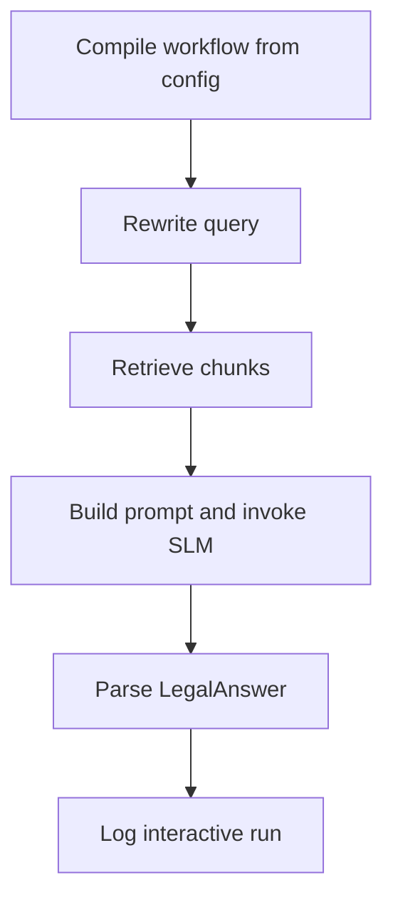

# legalos_rag

**Local helper package** for the RAG pipeline: config validation, graph orchestration, query rewriting, retrieval, prompt building, SLM invocation, and logging. Used by `chatbot/main.py` and `test.promptTester.promptRunBatch`. The separate `sourceLoader` entry point imports candidate sources for review.

---

### Directory structure

```text
legalos_rag/
├── README.md
├── __init__.py
├── runRag.py
├── queryRewriter.py
├── sourceLoader.py
├── workflow.py
└── prompt/
    ├── promptSchema.py
    └── prompts.py
```

---

## Module structure & execution flow

### `__init__.py`

- **_setup_slm(model_name)** — Build Ollama ChatOllama instance with the specified model name (temperature `0.3`).
- **ensure_requirements(config)** — Validate config and return `(db_path, promptTemplate, slm, model_name, logging)`. Required config keys:
  - `vectordbpath` — path to the Qdrant vector DB.
  - `promptTemplate` — object with a `"text"` key holding the full prompt template string.
  - `model.model_name` — Ollama model name (e.g. `"qwen2.5:3b-instruct"`).
  - `logging` (optional for batch runner) — object with `logfile`, `exclude_model_name`, `exclude_prompt`.


Used by both the interactive CLI (`chatbot.main`) and the batch runner (`test.promptTester.promptRunBatch`).

### `prompt/promptSchema.py`

Pydantic schemas for structured outputs: `LegalAnswer` (answer_found, act_name, section, explanation, citations) and `Citation` (pdf_number, page, file_name, quote).

### `prompt/prompts.py`

- Builds the **RAG prompt skeleton**:
  - Takes a full prompt template string (from config’s `promptTemplate.text`).
  - Injects `format_instructions` from the output parser.
  - Returns a LangChain `PromptTemplate` with `input_variables=["facts", "question"]` and `partial_variables={"format_instructions": ...}`.

### `queryRewriter.py`

- **rewrite_and_expand(query, slm)** — Uses the same Ollama model as the main SLM (temperature `0.3`) with a small legal-terminology prompt and `PydanticOutputParser` to produce two short search strings: **`rewritten`** (main issue in statutory-style language) and **`variant`** (related angle such as remedy or procedure). The model is instructed not to name specific Acts. Returns `[original, rewritten, variant]` on success, or `[original]` if parsing or the SLM fails (retrieval still runs on the user query only).

### `runRag.py`

Central RAG logic:

- **getFacts(q, db_path)** — Setup Qdrant vectorstore (HuggingFace embeddings), retrieve top-k chunks for a single query string, return them formatted as a single string for the prompt. Still available for single-query retrieval.
- **retrieve_documents(queries, db_path)** — For each query string, runs `similarity_search_with_score` with `k=3`, deduplicates hits by `(pdf_number, page)`, and returns up to **5** documents, retaining their text, IDs, and full metadata.
- **format_documents(docs)** — Formats documents into the existing `[DOC n]` prompt blocks with PDF number, page, and file name.
- **getFactsMulti(queries, db_path)** — Calls `retrieve_documents` and `format_documents` to keep the existing string-returning retrieval interface.
- **invoker(slm, retrievedChunks, query, template)** — Build output parser for `LegalAnswer`, build prompt from `prompt/prompts.setup_rag_prompt_skeleton`, format with facts and **the original user question** (not the rewrite), invoke the SLM, parse response into `LegalAnswer`. Returns `(parsed_result: LegalAnswer, final_prompt_text: str)`. Does **not** log.
- **log_rag_run(query, final_prompt, output, model, log_file, exclude_model_name, exclude_prompt)** — Append one RAG run as a JSONL line to the given log file. Called from `run_rag_loop()` in `chatbot/main.py` after each single RAG run (not from `run_rag`, which does not log).

### `sourceLoader.py`

`load_sources(config)` reads the configured POC JSON snapshots and their PDFs,
checks both SHA-256 hashes and source metadata, validates section records, and
returns one `{"sources": [...]}` corpus. The command writes this corpus only
after every source passes those structural checks. Setup, required inputs, and
the exact command are in [POC source loading](../README.md#load-the-poc-law-sources).

Each source contains its Act ID and name, PDF filename, `source_version` (the
PDF's SHA-256), snapshot JSON hash, update label, PDF page count, extraction and
coverage notes, footnotes, `review_status`, and `sections`.

Each section contains its number, title, unchanged snapshot `text`, PDF `pages`,
page footnotes, and `excerpts`. A section's `source_id` is
`<act_id>:<pdf_sha256>:section:<number>`. Excerpt IDs append
`:chars:<start>-<end>`; offsets are zero-based Python string positions with an
exclusive end, and each excerpt is exactly `section["text"][start:end]`.
Excerpts are at most 1,200 characters and split at spaces where possible.
Joining them reproduces the full section text without dropping qualifications.
These are search-sized excerpts, not independently complete legal rules.

Pages are the snapshot's **one-based PDF page numbers**, not the legacy vector
store's page indices. Excerpts inherit their parent section's page range; the
loader does not claim a precise page for each excerpt. Page-level footnotes are
retained separately from section body text, including any extraction artifacts.

All records have `review_status: "unreviewed"`. Matching hashes establish which
files were imported; they do not certify that extraction captured every
condition or section boundary correctly. The loader preserves the POC text for
the separate source-quality review and has no connection to the live RAG graph.
It does not enable a source, build a vector index, or require a model call.

### `workflow.py`

- **RAGState** — Typed shared state containing the unchanged original `query`, rewrites, `retrieved_sources` (LangChain documents), formatted `retrieved_chunks`, result, and final prompt.
- **build_rag_graph(db_path, prompt_template, slm)** — Builds the **rewrite → retrieve → generate** graph. Interactive and batch runs compile it once and reuse it for every question.

The state carries the output of one node into the next. This keeps each node focused on one task and avoids passing many separate values between functions.

The retrieval node retains the selected documents in `retrieved_sources` so later
steps can read their text and source metadata without parsing prompt text. The
same documents produce `retrieved_chunks`; ranking, page-based deduplication,
prompt formatting, and answer generation are unchanged. Metadata is retained as
stored, including absent fields; retrieval does not verify a legal source.
`query` remains the original question throughout rewriting and generation.
Question parts, stated facts, and evidence gaps will be added when nodes use them.

Direct graph callers can inspect `graph.invoke({"query": question})["retrieved_sources"]`.
The `chatbot.main.run_rag` tuple, interactive logs, and batch JSONL fields remain
unchanged. An empty search produces an empty source list and skips generation.

The graph is deliberately linear in this version. A future query-classifier node will decide which retrieval path a question needs. Direct questions can take a short path, while scenario-based or multi-issue questions can use more specialized processing.

---


## Retrieval workflow (before the prompt)

1. **rewrite_and_expand** — Turn the user question into one or three search strings (original plus optional legal phrasings).
2. **retrieve_documents** — Retrieve and merge evidence from all strings with deduplication by document page, retaining documents in state and formatting them with `format_documents`.
3. **invoker** — Answer using the original question text and retrieved chunks.

The compiled graph in `workflow.py` connects these steps. The existing rewrite, retrieval, and generation functions are reused without changing their behavior.

## Prompt workflow

End-to-end prompt formation looks like this:

1. **Config file**
   - Contains:
     - `vectordbpath`: path to the Qdrant DB (e.g. `"./vectorDB"`).
     - `promptTemplate`: object with a `"text"` key holding the full prompt template string.
     - `model.model_name`: Ollama model name for the SLM (e.g. `"qwen2.5:3b-instruct"`).
     - `logging`: object with `logfile`, `exclude_model_name`, `exclude_prompt`.

   Example:

   ```json
   {
     "vectordbpath": "./vectorDB",
     "promptTemplate": {
       "text": "You are a legal document reader...\\n\\nOutput:\\n{format_instructions}\\n\\nFacts:\\n{facts}\\n\\nQuery:\\n{question}"
     },
     "model": { "model_name": "qwen2.5:3b-instruct" },
     "logging": {
       "logfile": "chatbot/rag_runs.jsonl",
       "exclude_model_name": false,
       "exclude_prompt": true
     }
   }
   ```

2. **`prompt/prompts.setup_rag_prompt_skeleton(...)`**
   - Takes the `promptTemplate["text"]` string from the config.
   - Wraps it in a `PromptTemplate` with:
     - `{format_instructions}` filled from the output parser.
     - `{facts}` and `{question}` as runtime inputs.

3. **`runRag.invoker(...)`**
   - Calls `prompt.format(facts=retrievedChunks, question=query)` to produce the final string sent to the SLM, invokes the SLM, and parses the response into `LegalAnswer`.

4. **Logging via `runRag.log_rag_run(...)`**
   - The interactive session `run_rag_loop()` in `chatbot/main.py` calls `runRag.log_rag_run` with the query, final prompt text, parsed output, and model to append a JSON line to `rag_runs.jsonl` after each `run_rag()` call.

### Prompt workflow diagram



---

## Logging

The log file path is set in the config as `logging.logfile` (e.g. `chatbot/rag_runs.jsonl`). Each RAG run is appended as one JSONL line: timestamp, model, query, final_prompt, and parsed output, via `chatbot.legalos_rag.runRag.log_rag_run` from `run_rag_loop()` in `chatbot/main.py`. Config keys `logging.exclude_model_name` and `logging.exclude_prompt` control whether the model name and/or final prompt text are omitted from each log entry. Used for prompt-engineering iteration and review without re-running experiments.
