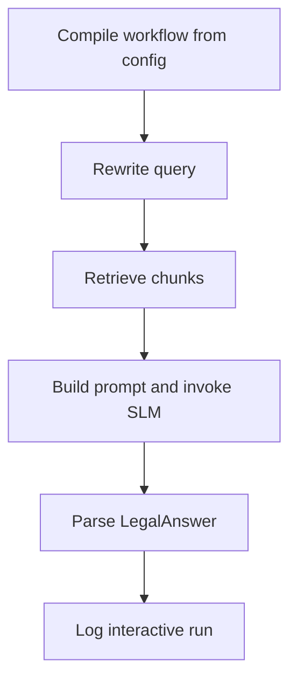

# legalos_rag

**Local helper package** for the RAG pipeline: config validation, graph orchestration, query rewriting, retrieval, prompt building, SLM invocation, and logging. Used by `chatbot/main.py` and `test.promptTester.promptRunBatch`. The separate `sourceLoader`, `sourceReview` and `sectionLookup` entry points import candidate sources, check them against their PDFs, and fetch complete sections. `questionSplitter` splits a question into legal parts and `factExtractor` records the facts a user states, and `referenceAgent` resolves a named Act and section.

---

### Directory structure

```text
legalos_rag/
├── README.md
├── __init__.py
├── runRag.py
├── queryRewriter.py
├── sourceLoader.py
├── sourceReview.py
├── sectionLookup.py
├── structuredCall.py
├── questionSplitter.py
├── factExtractor.py
├── referenceAgent.py
├── workflow.py
└── prompt/
    ├── promptSchema.py
    └── prompts.py
```

---

## Module structure & execution flow

### `__init__.py`

- **_setup_slm(model_name)** — Build Ollama ChatOllama instance with the specified model name (temperature `0.3`).
- **ensure_requirements(config)** — Validate config and return `(db_path, promptTemplate, slm, model_name, logging)`. Required config keys:
  - `vectordbpath` — path to the Qdrant vector DB.
  - `promptTemplate` — object with a `"text"` key holding the full prompt template string.
  - `model.model_name` — Ollama model name (e.g. `"qwen2.5:3b-instruct"`).
  - `logging` (optional for batch runner) — object with `logfile`, `exclude_model_name`, `exclude_prompt`.


Used by both the interactive CLI (`chatbot.main`) and the batch runner (`test.promptTester.promptRunBatch`).

### `prompt/promptSchema.py`

Pydantic schemas for structured outputs: `LegalAnswer` (answer_found, act_name, section, explanation, citations) and `Citation` (pdf_number, page, file_name, quote).

### `prompt/prompts.py`

- Builds the **RAG prompt skeleton**:
  - Takes a full prompt template string (from config’s `promptTemplate.text`).
  - Injects `format_instructions` from the output parser.
  - Returns a LangChain `PromptTemplate` with `input_variables=["facts", "question"]` and `partial_variables={"format_instructions": ...}`.

### `queryRewriter.py`

- **rewrite_and_expand(query, slm)** — Uses the same Ollama model as the main SLM (temperature `0.3`) with a small legal-terminology prompt and `PydanticOutputParser` to produce two short search strings: **`rewritten`** (main issue in statutory-style language) and **`variant`** (related angle such as remedy or procedure). The model is instructed not to name specific Acts. Returns `[original, rewritten, variant]` on success, or `[original]` if parsing or the SLM fails (retrieval still runs on the user query only).

### `runRag.py`

Central RAG logic:

- **getFacts(q, db_path)** — Setup Qdrant vectorstore (HuggingFace embeddings), retrieve top-k chunks for a single query string, return them formatted as a single string for the prompt. Still available for single-query retrieval.
- **retrieve_documents(queries, db_path)** — For each query string, runs `similarity_search_with_score` with `k=3`, deduplicates hits by `(pdf_number, page)`, and returns up to **5** documents, retaining their text, IDs, and full metadata.
- **format_documents(docs)** — Formats documents into the existing `[DOC n]` prompt blocks with PDF number, page, and file name.
- **getFactsMulti(queries, db_path)** — Calls `retrieve_documents` and `format_documents` to keep the existing string-returning retrieval interface.
- **invoker(slm, retrievedChunks, query, template)** — Build output parser for `LegalAnswer`, build prompt from `prompt/prompts.setup_rag_prompt_skeleton`, format with facts and **the original user question** (not the rewrite), invoke the SLM, parse response into `LegalAnswer`. Returns `(parsed_result: LegalAnswer, final_prompt_text: str)`. Does **not** log.
- **log_rag_run(query, final_prompt, output, model, log_file, exclude_model_name, exclude_prompt)** — Append one RAG run as a JSONL line to the given log file. Called from `run_rag_loop()` in `chatbot/main.py` after each single RAG run (not from `run_rag`, which does not log).

### `sourceLoader.py`

`load_sources(config)` reads the configured POC JSON snapshots and their PDFs,
checks both SHA-256 hashes and source metadata, validates section records, and
returns one `{"sources": [...]}` corpus. The command writes this corpus only
after every source passes those structural checks. Setup, required inputs, and
the exact command are in [POC source loading](../README.md#load-the-poc-law-sources).

Each source contains its Act ID and name, PDF filename, `source_version` (the
PDF's SHA-256), snapshot JSON hash, update label, PDF page count, extraction and
coverage notes, footnotes, `review_status`, and `sections`.

Each section contains its number, title, unchanged snapshot `text`, PDF `pages`,
page footnotes, and `excerpts`. A section's `source_id` is
`<act_id>:<pdf_sha256>:section:<number>`. Excerpt IDs append
`:chars:<start>-<end>`; offsets are zero-based Python string positions with an
exclusive end, and each excerpt is exactly `section["text"][start:end]`.
Excerpts are at most 1,200 characters and split at spaces where possible.
Joining them reproduces the full section text without dropping qualifications.
These are search-sized excerpts, not independently complete legal rules.

Pages are the snapshot's **one-based PDF page numbers**, not the legacy vector
store's page indices. Excerpts inherit their parent section's page range; the
loader does not claim a precise page for each excerpt. Page-level footnotes are
retained separately from section body text, including any extraction artifacts.

All records have `review_status: "unreviewed"`. Matching hashes establish which
files were imported; they do not certify that extraction captured every
condition or section boundary correctly. The loader preserves the POC text for
the separate source-quality review and has no connection to the live RAG graph.
It does not enable a source, build a vector index, or require a model call.

### `sourceReview.py`

`review_sources(config)` checks every Act in the loaded corpus against its PDF and
returns one `passed` or `failed` record per Act with its `source_version`, the
number of sections checked, and a list of findings. `review_source(source,
pdf_directory)` does this for one Act. The command writes the result to the
`review_file` in the config. The checks work on words only (letters, lower case), so
footnote markers and punctuation in the PDF do not matter.

- **PDF identity** — the PDF page count equals `source_pages` and the first part of
  the Act's name (up to its first comma) appears at the start of the PDF. The file hash was already checked when the
  sources were loaded.
- **Section boundaries** — a section heading is accepted only if a line starting
  with the section number, followed by the same first title words, is found on the
  section's first recorded page and after the previous section's heading.
- **Section text** — the PDF words between a heading and the next heading (or the
  end of the section's last page) must appear in the section text and its footnotes.
  A section fails when more than 5% of them (at least 5 words) are missing.
- **Qualifications** — each `Provided that`, `Explanation`, `Exception` and
  `Illustration` that opens a clause in the PDF must also be in the section.
  Amendment notes such as "for the Explanation" are not counted.

Chapter headings are not section text and are skipped. Reading stops at the first
schedule heading on or after the last section's first page, so schedules are not
mistaken for section text; schedule headings in the table of contents are ignored.
The check does not review Schedules or associated Rules.

`load_verified_source(config, act_id)` is the gate for the new retrieval path. It
returns an Act only when the review file shows `passed` for that Act's current
`source_version`, and raises `ValueError` for an unknown Act, a failed or missing
review, or a source version that has changed since the review. Nothing calls it yet;
later steps use it before reading an Act.

Passing is a text comparison with the PDF, not legal approval. Findings are not
waived automatically; an Act with any finding stays refused until it is reviewed.

### `sectionLookup.py`

`fetch_section(config, source_id)` returns the complete section for a section ID
(`<act_id>:<source_version>:section:<number>`) or one of its excerpt IDs (the same
ID plus `:chars:<start>-<end>`). A search that finds an excerpt can call it to read
the whole provision, so provisos, explanations and other conditions outside the
excerpt are not lost.

The result has `act_id`, `act_name`, `source_version`, the section's `source_id`,
`section`, `title`, `text`, `pages` and `footnotes`. `text` is the unchanged section
text; the excerpts are not returned. The function calls
`sourceReview.load_verified_source`, so it works only for an Act that has passed its
source check for the ID's `source_version`. It raises `ValueError` for a malformed
ID, an unknown Act, section or excerpt, a different source version, or an Act that
has not passed. The `sectionLookup` command prints the same result as JSON; usage is
in [Fetch a complete section](../README.md#fetch-a-complete-section).

### `structuredCall.py`

`ask_model(slm, template, schema, **inputs)` fills a prompt template, calls the same
Ollama model as `slm` at temperature 0, and parses the reply into a Pydantic schema,
using the same parser as the query rewriter. It raises on a parse or model error so
each caller chooses its own fallback. The next model-based steps reuse it.

### `questionSplitter.py`

`split_question(question, slm)` returns `{"question": <original>, "parts": [...]}`.
Each part is `{"id": "p1", "question": ..., "facts": [...]}`. The model proposes the
parts and code checks them:

- **Facts** are kept only when they are exact phrases of the original question
  (compared on words, ignoring case and punctuation).
- **Wording**: a part may rearrange the user's words but at most 20% of its words may
  be new; otherwise the whole question stays one part.
- **Size**: zero parts or more than four parts also keep one part.
- **Failure**: any model or parse error keeps one part.

The prompt asks for one part unless the user asks about different Acts or unrelated
situations. Several details of one problem, such as where to file and the deadline,
stay together.

Measured with `qwen2.5:3b-instruct` on 18 reviewed questions (12 written first, 6 held
back and run once): 16 gave a defensible number of parts. None of the 8 single-problem
questions was split. Two questions with unrelated situations in one flowing text, not
named Acts, stayed as one part. This under-splitting loses no facts. The `facts` list
is best effort: the model sometimes leaves it empty even when the part's own text
states the fact. Exact fact extraction is a separate step. Nothing in the live graph
calls the splitter yet.

### `factExtractor.py`

`extract_facts(question, slm)` returns `{"question": <original>, "facts": [{"id": "f1", "quote": ...}]}`. The model proposes quotes and code keeps a quote only when:

- it appears word for word in the question (ignoring case and spacing), and the quote is stored exactly as the user wrote it;
- it is not a question (it contains no `?`);
- it is not an imagined case: no `if`, `suppose`, `assume`, `unless`, `whether` or `imagine` appears in the quote or earlier in its sentence.

A fact is the quote itself, not a reworded summary, so no date, count or relationship can be added that the user did not write. A fact the user did not give is absent, which later steps read as unknown. A model or parse error records no facts.

Measured with `qwen2.5:3b-instruct`: on 12 questions used while writing the checks, all 12 were correct and all 9 expected facts were found. On 6 further questions run once, 5 were correct and 4 of 5 expected facts were found; the miss was a left-out fact ("We are three partners"), not an invented one. The model returned the question itself as a fact once and returned imagined cases several times; the code removed all of these. A test that feeds the code invented quotes (a date, a relationship, an imagined headcount) confirmed none is kept. A quote can hold more than one fact, such as two sentences. Nothing in the live graph calls the extractor yet.

### `referenceAgent.py`

`resolve_references(config, question)` returns one result for each section number named in
the question, in order. It is plain code: no model is called and no search score is used,
so a high-ranking search hit cannot confirm a reference.

- **Section**: found by `section`, `sec` or `s.` followed by a number such as `13B`, a list
  such as `5 and 6`, and an optional subsection such as `(1)(a)`. A bare number without
  one of these words is not read as a section.
- **Act**: an Act is recognised from its name without the year and any bracketed text
  (for example "Hindu Marriage"), or an alias from the config, with or without "Act" and
  a year. It is paired with a section when it follows directly after `of`, `under`, `in`,
  `to` or `from`; several Acts joined by `and`, `or` or a comma give one result each. If a
  section has no Act directly after it, the Act is used only when the question names
  exactly one Act; otherwise the result is `ambiguous`.
- **Checks**: the Act must pass `sourceReview.load_verified_source` for its current source
  version, a year in the question must match the supported Act, and the section number
  must exist in the Act. The provision comes from `sectionLookup.fetch_section`, so it is
  the full text with pages and footnotes. A requested subsection is returned in
  `subsection`; the provision is always the whole section.
- **Other Acts**: a capitalised phrase ending in "Act" that is not a supported Act gives
  `unsupported_act`. A name followed by more title words, such as "Hindu Marriage
  Amendment Act", is a different Act and is never verified as the supported one.
- **Ambiguity**: candidates are the checked Acts that have that section number, with the
  section's title and source ID but no text. Candidate search by meaning or keywords is
  added with the shared retriever and is not used here.

Limits: a section is recognised only after the word `section`, `sec` or `s.`; "Hindu Marriage
Act 13" returns nothing. A phrase such as "section 13 of my building" is reported as
ambiguous, not ignored. An amending Act written with brackets, such as "Hindu Marriage
(Amendment) Act", is reported as ambiguous, never as the supported Act. Rules and schedules
are not covered. Nothing in the live graph calls this yet.

### `workflow.py`

- **RAGState** — Typed shared state containing the unchanged original `query`, rewrites, `retrieved_sources` (LangChain documents), formatted `retrieved_chunks`, result, and final prompt.
- **build_rag_graph(db_path, prompt_template, slm)** — Builds the **rewrite → retrieve → generate** graph. Interactive and batch runs compile it once and reuse it for every question.

The state carries the output of one node into the next. This keeps each node focused on one task and avoids passing many separate values between functions.

The retrieval node retains the selected documents in `retrieved_sources` so later
steps can read their text and source metadata without parsing prompt text. The
same documents produce `retrieved_chunks`; ranking, page-based deduplication,
prompt formatting, and answer generation are unchanged. Metadata is retained as
stored, including absent fields; retrieval does not verify a legal source.
`query` remains the original question throughout rewriting and generation.
Question parts, stated facts, and evidence gaps will be added when nodes use them.

Direct graph callers can inspect `graph.invoke({"query": question})["retrieved_sources"]`.
The `chatbot.main.run_rag` tuple, interactive logs, and batch JSONL fields remain
unchanged. An empty search produces an empty source list and skips generation.

The graph is deliberately linear in this version. A future query-classifier node will decide which retrieval path a question needs. Direct questions can take a short path, while scenario-based or multi-issue questions can use more specialized processing.

---


## Retrieval workflow (before the prompt)

1. **rewrite_and_expand** — Turn the user question into one or three search strings (original plus optional legal phrasings).
2. **retrieve_documents** — Retrieve and merge evidence from all strings with deduplication by document page, retaining documents in state and formatting them with `format_documents`.
3. **invoker** — Answer using the original question text and retrieved chunks.

The compiled graph in `workflow.py` connects these steps. The existing rewrite, retrieval, and generation functions are reused without changing their behavior.

## Prompt workflow

End-to-end prompt formation looks like this:

1. **Config file**
   - Contains:
     - `vectordbpath`: path to the Qdrant DB (e.g. `"./vectorDB"`).
     - `promptTemplate`: object with a `"text"` key holding the full prompt template string.
     - `model.model_name`: Ollama model name for the SLM (e.g. `"qwen2.5:3b-instruct"`).
     - `logging`: object with `logfile`, `exclude_model_name`, `exclude_prompt`.

   Example:

   ```json
   {
     "vectordbpath": "./vectorDB",
     "promptTemplate": {
       "text": "You are a legal document reader...\\n\\nOutput:\\n{format_instructions}\\n\\nFacts:\\n{facts}\\n\\nQuery:\\n{question}"
     },
     "model": { "model_name": "qwen2.5:3b-instruct" },
     "logging": {
       "logfile": "chatbot/rag_runs.jsonl",
       "exclude_model_name": false,
       "exclude_prompt": true
     }
   }
   ```

2. **`prompt/prompts.setup_rag_prompt_skeleton(...)`**
   - Takes the `promptTemplate["text"]` string from the config.
   - Wraps it in a `PromptTemplate` with:
     - `{format_instructions}` filled from the output parser.
     - `{facts}` and `{question}` as runtime inputs.

3. **`runRag.invoker(...)`**
   - Calls `prompt.format(facts=retrievedChunks, question=query)` to produce the final string sent to the SLM, invokes the SLM, and parses the response into `LegalAnswer`.

4. **Logging via `runRag.log_rag_run(...)`**
   - The interactive session `run_rag_loop()` in `chatbot/main.py` calls `runRag.log_rag_run` with the query, final prompt text, parsed output, and model to append a JSON line to `rag_runs.jsonl` after each `run_rag()` call.

### Prompt workflow diagram



---

## Logging

The log file path is set in the config as `logging.logfile` (e.g. `chatbot/rag_runs.jsonl`). Each RAG run is appended as one JSONL line: timestamp, model, query, final_prompt, and parsed output, via `chatbot.legalos_rag.runRag.log_rag_run` from `run_rag_loop()` in `chatbot/main.py`. Config keys `logging.exclude_model_name` and `logging.exclude_prompt` control whether the model name and/or final prompt text are omitted from each log entry. Used for prompt-engineering iteration and review without re-running experiments.
