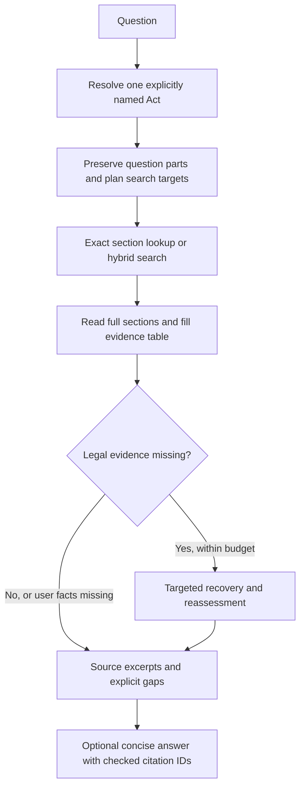

# Evidence-recovery POC

This isolated POC collects evidence for each part of a question before answering. It uses the model configured for the original chatbot in [`config/rag_v1.json`](../../../config/rag_v1.json), currently `qwen2.5:3b-instruct`. The original entry point is unchanged.

## Architecture



The planner, evidence reader and optional writer reuse the same local language model. A Python controller manages retrieval and stopping; there are no autonomous agents.

- `catalog.py` selects one Act by explicit name or alias. Missing or multiple Acts require clarification.
- `corpus.py` combines BM25 and CPU BGE search, then reranks candidates using MiniLM on ONNX Runtime. Both retrieval model revisions are pinned. Each question part and its search target are ranked separately. Exact references bypass search.
- `workflow.py` reads complete parent sections, maintains a separate evidence row for each need, and includes explicit subsection dependencies and certain exception/scope clauses. One recovery round permits two operations, within twelve total tool calls and ten model calls.
- `model.py` constrains question text and source IDs. The reader selects evidence and reports missing legal text or user facts. Code derives coverage from those fields; relevance still requires model judgment.
- `facts.py` handles narrow POSH worker-count and missing-incident-date cases. It is not a general eligibility or date calculator.
- `answer.py` optionally summarizes selected evidence. Invalid drafts fall back to source excerpts. Citation membership does not prove semantic correctness.
- `trace.py` saves full prompts, raw responses, retrieval, evidence tables, decisions, errors, timings and provenance in append-only JSONL with flush/fsync.

The original pipeline rewrites, retrieves from its all-Acts Qdrant collection, and generates. This POC additionally changes source preparation and retrieval, so an end-to-end result does not isolate the benefit of recovery alone.

## Run

Use Python 3.11 and a separate environment. From the repository root:

```bash
python3.11 -m venv .venv
.venv/bin/python -m pip install -r chatbot/legalos_rag/poc_v2/requirements.txt
.venv/bin/python -m chatbot.legalos_rag.poc_v2.main \
  --question "Under the Juvenile Justice Act, what are the eligibility requirements for prospective adoptive parents?" \
  --draft --output test/promptTester/outputs/poc-example
```

Ollama must be running with the configured model already installed. BGE and MiniLM download once if absent; cached retrieval can run with `HF_HUB_OFFLINE=1`. The POC itself does not need Qdrant.

`--draft` enables the prose writer; otherwise the answer contains source excerpts. `--no-recovery` disables the recovery round. The default catalog covers the six sources below. `--catalog` accepts an alternative catalog of supported pinned sources. The model default always follows the original config; `--model` is only an explicit experiment override.

Each request writes `events.jsonl`, `result.json` and `answer.md`; setup has its own trace. Full traces contain the original questions and facts. Keep them local under the gitignored outputs directory.

## Included sources

| Act | Source PDF | Snapshot date stated by PDF | Numbered sections |
|---|---|---|---:|
| POSH | A2013-14.pdf | 2021-08-31 | 30 |
| Hindu Marriage | A1955-25.pdf | Not stated | 37 |
| Motor Vehicles | aA1988-59.pdf | 2025-05-21 | 256 |
| Juvenile Justice | a2016-2.pdf | Not stated | 112 |
| CGST | a2017-12.pdf | 2025-05-26 | 188 |
| Consumer Protection | eng201935.pdf | 2021-09-17 | 107 |

`data/` contains the extracted sections, units, PDF page references, amendment notes and source SHA-256 values. The corpus loader checks source identity, Act consistency, section counts and duplicate IDs. These are all numbered sections from each snapshot, not just the benchmark's answer passages. The original PDFs came from the project's local India Code collection; the PDFs and embedding caches are excluded from this branch.

Section boundaries were checked against the source contents and benchmark passages inspected against rendered PDF pages. This is not a legal review of every provision. Extraction retains some OCR spacing artifacts. Section-reference links are extraction-derived, not a complete verified legal dependency graph. Rules, schedules, later amendments and multi-Act reasoning are outside this POC.

## Checks and results

```bash
.venv/bin/python -m test.promptTester.poc_v2.checks
.venv/bin/python -m test.promptTester.poc_v2.compare \
  --database /absolute/path/to/vectorDB \
  --output test/promptTester/outputs/poc-comparison
```

The comparison requires a new output directory and runs the original functions followed by the POC, serially, on the same configured model. Both use CPU embeddings and matched sampling settings. The ten questions are known development cases, not a held-out estimate.

The [high-level run summary](../../../test/promptTester/poc_v2/results/comparison.md) records historical comparisons, significant improvements and remaining failures. It is the only committed run-result document; detailed answers, provenance and stepwise traces remain local. Historical results are not a fresh benchmark of the current configured model. Contract checks verify boundaries and controller behavior; automated source coverage and actual answer quality are reported separately.
